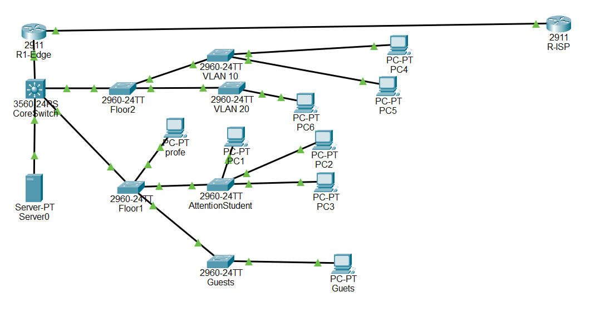

# Lab 03— Servidor DHCP, Enrutamiento Inter-VLAN y NAT/PAT
En este laboratorio armamos y probamos una red segmentada por VLANs donde los equipos obtienen su dirección IP de forma automática desde un servidor DHCP (`Server0`), el switch multicapa (`CoreSwitch`) se encarga de enrutar entre VLANs y reenviar las peticiones DHCP con `ip helper-address`, y el router de borde (`R1-Edge`) saca el tráfico permitido hacia el proveedor (`R-ISP`) usando NAT/PAT (`overload`).

## Direccionamiento IP y VLANs

| Segmento / VLAN | Red / Subred | Gateway / Interfaz | Notas de diseño |
| :--- | :--- | :--- | :--- |
| **WAN Edge - ISP** | `200.10.10.0/30` | `R1-Edge`: `200.10.10.2` `R-ISP`: `200.10.10.1` | Enlace punto a punto hacia el ISP |
| **Enlace Edge - Core** | `10.0.0.0/30` | `R1-Edge` (`Gi0/1`): `10.0.0.1` `CoreSwitch` (`Fa0/1`): `10.0.0.2` | Puerto enrutado (`no switchport`) |
| **VLAN 10** | `192.168.10.0/24` | `Vlan10`: `192.168.10.1` | Incluida en `LAN_NAT` |
| **VLAN 20** | `192.168.20.0/24` | `Vlan20`: `192.168.20.1` | Incluida en `LAN_NAT` |
| **VLAN 30** | `192.168.30.0/24` | `Vlan30`: `192.168.30.1` | Incluida en `LAN_NAT` |
| **VLAN 50** | `192.168.50.0/24` | `Vlan50`: `192.168.50.1` | Servidor DHCP (`192.168.50.10`) — fuera de `LAN_NAT` |
| **VLAN 60** | `192.168.60.0/24` | `Vlan60`: `192.168.60.1` | Fuera de `LAN_NAT` |
| **VLAN 70 (Guests)** | `192.168.70.0/24` | `Vlan70`: `192.168.70.1` | Red de invitados, incluida en `LAN_NAT` |

Se evita que el la vlan de Servers no salga de la LAN pra fines practicos y de laboratorio especificando la seguridad de vlan con redes externas, 